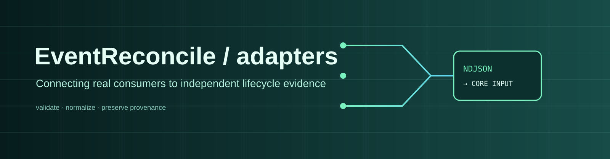
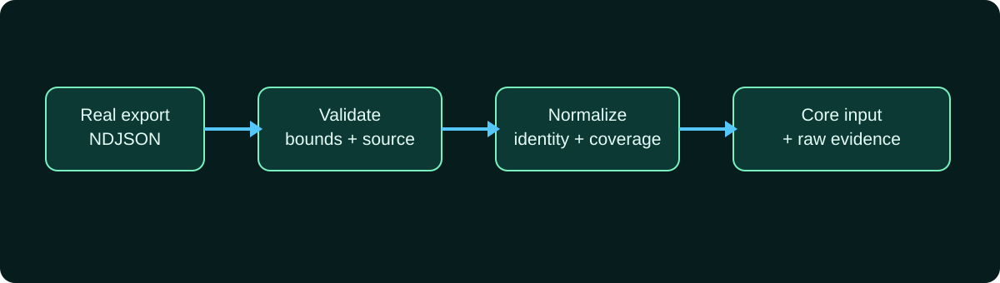

# EventReconcile-adapters



[](https://github.com/EventReconcile/EventReconcile-adapters/actions/workflows/ci.yml) [](LICENSE) [](https://go.dev/) [](docs/PROJECT_STATUS.md)

Source adapters that connect real event exports to independent lifecycle evidence while preserving provenance and uncertainty.

## Repository role

Adapters own source-specific decoding, validation, normalization and provenance mapping. The first integration is SoroTrail NDJSON. It refuses to substitute `op_index` for `event_index`; documented exports without canonical event identity remain source-scoped and cannot establish cross-source completeness.

## Architecture



The loader accepts bounded `type: "contract"` records from one contract per export, preserves raw lines, and performs no network access. Unknown SoroTrail coverage remains `INCONCLUSIVE` downstream.

## Quickstart

Requirements: Go 1.25.x.

```powershell
go vet ./...
go test -count=1 ./...
go run ./cmd/sorotrail-normalize --reference ref.ndjson --observed observed.ndjson --output input.json
```

Then run the independent CLI from its repository:

```powershell
go run ./cmd/eventreconcile --input input.json --output report.json
```

## Documentation and status

- [Project status](docs/PROJECT_STATUS.md)
- [Contributing](CONTRIBUTING.md)
- [Security](SECURITY.md)
- [Code of conduct](CODE_OF_CONDUCT.md)
- [Changelog](CHANGELOG.md)
- [Fixtures](fixtures/)

## Related repositories

- [EventReconcile-core](https://github.com/EventReconcile/EventReconcile-core) — authoritative contracts and reconciliation engine.
- [EventReconcile-cli](https://github.com/EventReconcile/EventReconcile-cli) — offline execution and report output.

## License

Licensed under [Apache-2.0](LICENSE).
